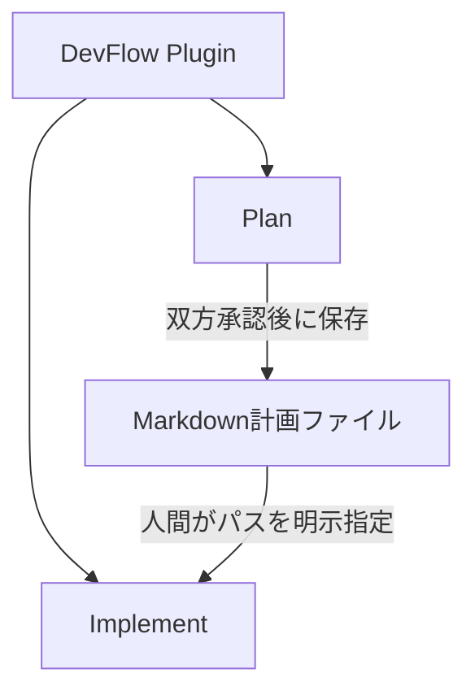
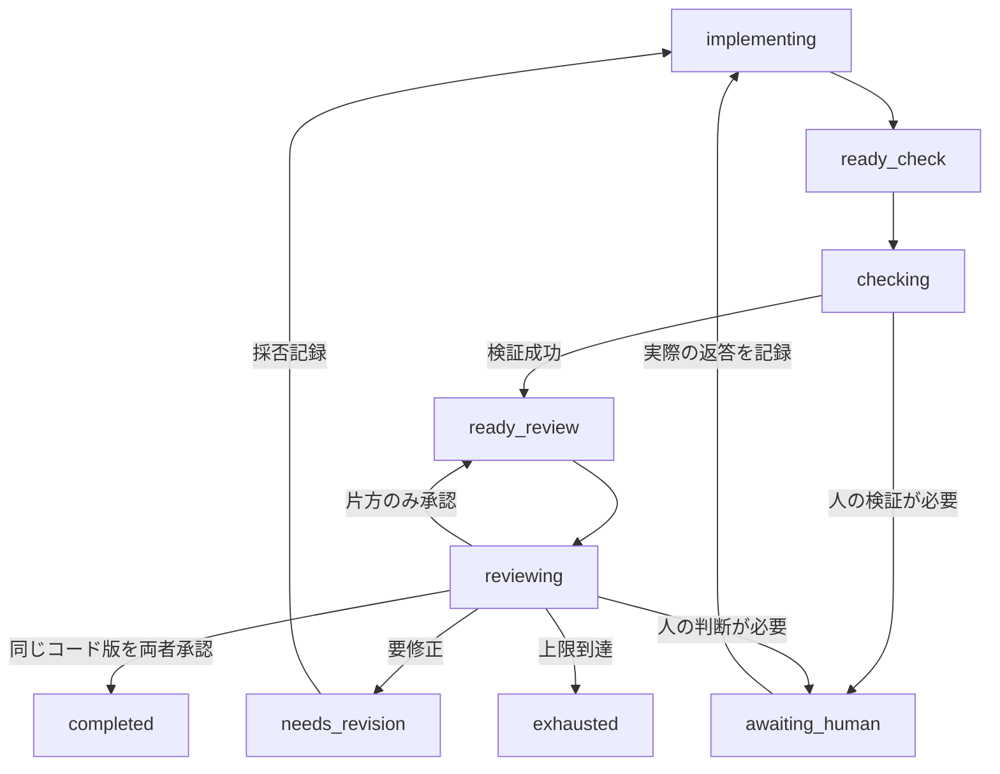

# DevFlowの設計

## 一つの配布と独立したワークフロー

DevFlow 0.1.3 は一つのプラグイン内に Plan と Implement を配置します。`dependencies` による兄弟プラグイン導入はありません。共通エントリーポイントと hooks が現在のセッションを対応するフローへ振り分けますが、Plan のエンジンが Implement を直接呼ぶ構成ではありません。

PlanFlowを使わずに作成したMarkdownファイルもBuildFlowへ渡せます。BuildFlowはPlanFlowのrun ID・状態ファイル・Pythonモジュールを理解する必要がありません。計画・設定・実行記録の形式はそれぞれで管理します。

同一セッション内でのアクティブなPlanFlow/BuildFlowの重複はサポートしません。一方を完了・キャンセルしてから、次のユーザー入力で他方を開始します。同じプロジェクトを複数のセッションが並行して変更することも避けます。

## 共通化の範囲

共通処理の正本は`shared/flow_common/`です。ファイル保存・ハッシュ・ロック・レビュー上限と承認判定等、両フローで意味が同じ部分を置きます。

`tools/sync_shared.py`で `plugins/devflow/components/{planflow,buildflow}/scripts/*_core/_vendor/flow_common/` へ機械的に組み込みます。正本を一つに保ちつつ、各コンポーネントを独立してテストできます。インストールした DevFlow は自分のディレクトリ内からのみ読み込むため、配布リポジトリの `shared/` を実行時に参照しません。

`components/planflow` と `components/buildflow` は内部コンポーネント名です。別のインストール対象ではありません。利用者向けコマンドは常に `/devflow:*` です。

| 境界 | 役割 |
|---|---|
| `skills/` | 人間の明示操作を受け、Claude Codeへ状態に応じた作業を指示 |
| `scripts/devflow.py` | 単一の起動・設定・status/doctor とフローの振り分け |
| `hooks/`と`hooks.py` | 開始意図・人間の返答を記録し、許可状態・対象範囲を検査 |
| `engine.py` | 状態遷移、レビュー回数、承認、エスカレーション、復旧を管理 |
| `snapshot.py` | 対象範囲の実ファイルを保存し、開始時からの差分を計算 |
| `checks.py` | 事前承認済みのプロジェクト固有チェックを引数配列で実行 |
| `adapters.py` | 外部CLIの起動・設定分離・出力検証 |
| `config/`・`schemas/`・`prompts/` | 設定、機械検証できる契約、レビュー観点 |
| `_vendor/flow_common/` | 配布物に自己完結させた共通ライブラリ |

変更時は共通コードの正本を編集し、同期後に両方のテストを実行します。生成先を直接変更してはいけません。`tools/sync_shared.py --check`とパッケージ検査が生成物の不一致を検出します。

## Plan の状態と正式保存

面接は設定 `plan.grill_skill` で指定した外部スキルを、Claude Code の `Skill` ツールから直接呼び出します。既定値は `grilling` です。この依存は Plan だけで使用し、実装フローの入力契約には含めません。自動呼び出しを拒否された場合は停止し、外部スキルや権限を変更したり、別のスキルに黙って置き換えたりしません。

`interview` → `planning` → `ready` → `reviewing` と進みます。通常の指摘は `awaiting_revision`、人間の判断は `awaiting_human`、技術的停止は `paused_error` です。両レビュアーが同一ハッシュを承認したときだけ `completed` となります。

レビュー完了後、スキルが `plan publish` と `plan report` を呼びます。出版状態 `publication.status` は `pending` / `publishing` / `published` / `error` / `disabled` を区別します。`completed` だけでは正式ファイルの保存成功を意味しません。

既定保存先は `docs/plans/`、ファイル名は依頼中の最初の `REVIEW-10` のようなチケット識別子、なければ `plan-<run-id>.md` です。既存の一次候補があれば `<識別子>-<run-id>.md` に分離し、そちらも存在する場合は上書きせず停止します。正式ファイルはレビュー済みのバイト列と同じです。公開時に見出しやメタデータを付加して未レビューの変更を混ぜません。

`exhausted` / `awaiting_human` / `paused_error` のプランを自動的に正式採用しません。別の人間採用経路は双方承認と区別する必要がありますが、本版に自動承認の迂回機能はありません。

## Implement の状態遷移

図は主要経路だけを示しています。人への問い合わせから戻る先は問い合わせ時の状態に依存します。例えば手動検証の承認後はレビュー待ちへ戻ります。技術的失敗は`paused_error`、人間の中止は`cancelled`です。

計画の実装・修正は現在のClaude Codeメインセッションが担当します。Pythonランナーが新しいClaudeセッションを起動することはありません。ランナーは明示的なアクション単位で進み、Claudeは返された状態を読んで次のアクションを選びます。

## 同じコード版の定義

スナップショットIDは、対象範囲の相対パス、ファイル内容ハッシュ、サイズ、実行属性から計算します。時間やGitのステータス表示そのものでは決まりません。

Gitモードでは、対象範囲内の追跡済みファイルとGitに無視されていない未追跡ファイルを読みます。`files`モードはGitを使わず、明示した範囲を列挙します。自動的に片方から他方へ切り替えません。

開始時の作業ツリーをベースラインにし、そこから現在の候補までの累積差分を各レビューへ渡します。HEADだけを基準にすると、開始前の利用者の変更をBuildFlowの変更と誤認するためです。

スナップショット保存中にファイル一覧・属性が変わった場合は停止します。これは同時編集を検出するための検査であり、ファイルシステム全体をロックする仕組みではありません。チェックやレビュー後にもハッシュを確認し、古いコードに対する結果を新しいコードへ適用しないようにします。

## 検証・レビュー・回数

1. 実装概要と候補コードを固定します。
2. 必須チェックを実行します。未設定なら人の実確認を求めます。
3. 外部送信前にレビュー枠を予約し、パケットのハッシュを保存します。
4. 指定のレビュアーを1回だけ起動します。
5. スキーマ、終了状態、スナップショットIDを確認します。
6. 各指摘の採否を記録し、必要ならClaude Codeが修正します。

レビュー回数は最大6回、既定順序はCodex/OpenCodeの交互です。送信後の失敗も数えます。返答が得られなかったからといって枠を戻さず、再開時にもリセットしません。

両者の合格が**同じスナップショットID**に揃ったときだけ早期完了します。6回目のレビュー後に修正した場合は、最終修正がレビューされていないことを報告します。チェックの再試行上限はレビュー上限と別管理です。通常のテスト失敗の無限修正ループも避け、上限時は人間へ戻します。

## 外部CLIの交換点

エンジンは共通のレビューJSONを扱い、CLI固有のオプションやイベント形式はアダプターで吸収します。設定だけで未実装のツールを任意に実行するのではなく、新しいツールを追加する際は専用アダプターとテストを実装します。

モデル名・推論設定は設定として保持し、実行開始後は固定します。OpenCodeのv1/v2は明示的に区別します。CLIの未知の出力・途中終了・禁止ツール呼び出しを、都合よく読み替えて合格にはしません。

## 状態保存と復旧

対象プロジェクトの `.devflow/runs/plan/RUN_ID/` と `.devflow/runs/implement/RUN_ID/` に、計画、設定、ベースライン、スナップショット、チェック、レビュー、採否、人間回答を保存します。セッション対応は `.devflow/sessions/{plan,implement}/` に分けます。確定記録は上書きしません。状態更新は一時ファイルとrename、確定記録は排他的公開、複数ファイルの更新はtransaction記録で整合性を保ちます。

ロックが残っても、時間だけを見て自動削除しません。中断されたレビューは実行されたかもしれないため、人間がプロセス終了を確認してから復旧します。自動復旧で外部モデルを再送信することはありません。

終了時には実際の作業ツリーを再確認し、`reports/final-XXXXXX.json`へその時点のレポートを確定保存します。`status`は保存したレポートを返します。後日ソースが変わった場合に過去のレポートまで書き換える設計ではなく、現在のライブ状態の証明と混同しないでください。

報告では`workspace_matches_checkpoint_at_report`、`final_workspace_verified`、`final_snapshot_reviewed`を分けます。最終スナップショットを取得できなかった場合、`unreviewed_final_changes`を`null`にして不明と表し、変更なし・確認済みとは扱いません。

## 拡張時の原則

- プロジェクト固有のテスト・ビルドは`checks`設定で交換し、フロー本体へUnity/Next.js等の条件分岐を埋め込まない。
- レビューの入出力、状態遷移、プランファイルという境界を保つ。
- 共通化は保存や不変条件から始め、PlanFlow特有のインタビューとBuildFlow特有のソース編集を混ぜない。
- 新機能は必ず中断・失敗・権限拒否の経路までテストする。
- 自動化を増やす場合も、通常の権限や人間の承認を無効化しない。
