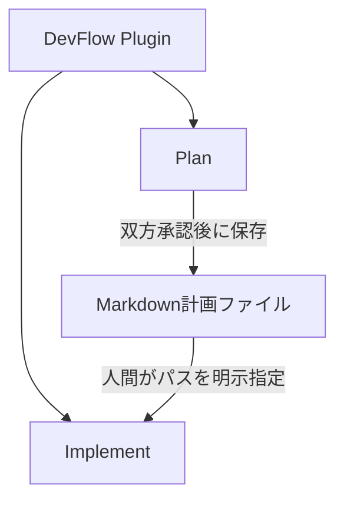
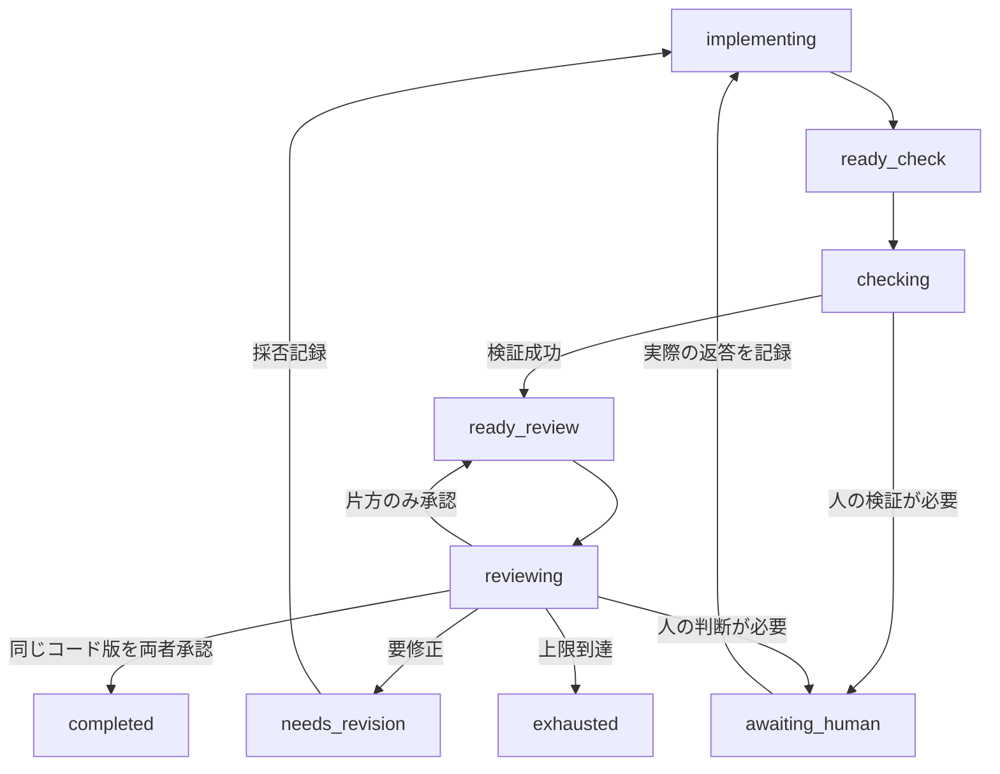

# DevFlowの設計

## 一つの配布と独立したワークフロー

DevFlow 0.2.0 は一つのプラグイン内に Plan と Implement を配置します。`dependencies` による兄弟プラグイン導入はありません。共通エントリーポイントと hooks が現在のセッションを対応するフローへ振り分けますが、Plan のエンジンが Implement を直接呼ぶ構成ではありません。

Plan を使わずに作成した Markdown ファイルも Implement へ渡せます。Implement は Plan の run ID・状態ファイル・Python モジュールを理解する必要がありません。

1つのプロジェクトで未完了の run は1つだけです。同一セッション内で2つのフローを重ねて使うことはサポートしません。一方を完了・キャンセルしてから、次のユーザー入力で他方を開始します。

## パッケージの構成

Python コードは `plugins/devflow/scripts/devflow_core/` の1つのパッケージです。コピーした共通コードや同期ツールはありません。

| 場所 | 役割 |
|---|---|
| `skills/` | 人間の明示操作を受け、Claude Code へ状態に応じた作業を指示 |
| `scripts/devflow.py` | 唯一の起動点 |
| `devflow_core/cli.py` | 登録表から組み立てる1つの argparse。エラーは常に JSON |
| `devflow_core/router.py` | セッションの紐付け、開始、resume、空き確認、フックの振り分け。フロー名で分岐しない |
| `devflow_core/workflows.py` | ワークフローの登録表 |
| `devflow_core/common/` | 全フロー共通の仕組み（下表） |
| `devflow_core/plan/`、`devflow_core/implement/` | 各フローの状態遷移、レビューに送る内容と結果の項目、固有の許可規則。`defaults.json`・`reviewer.md`・`review.schema.json` を同じ場所に置く |

| `common/` のモジュール | 役割 |
|---|---|
| `runs.py` | run の記録（RunStore）：共通の state の枠、ロック、transaction、作成、検査、人間の発言の記録、所有者の移譲、外部処理の予約・確定（`reserve` / `claim`）と `recover` |
| `engine.py` | 各フローのエンジンの基底クラス（RunEngine）：RunStore の利用、所有者の確認、凍結した設定の読み取り |
| `process.py` | チェックとレビュアー CLI で共通の、出力上限・時間切れ・プロセスツリー停止付きの子プロセス実行 |
| `sessions.py` | セッション記録、承認に使える回答の規則、回答文の取り出し |
| `guard.py` | PreToolUse の判定の骨組み：読み取り専用ツール、Bash の検査、ランナー呼び出しの解析、パス検査、プラグイン保護 |
| `reviewers.py` | Codex / OpenCode の事前確認・起動・分離・出力検査 |
| `settings.py` | `devflow.config.json` の重ね合わせと、レビュアー設定の共通規則 |
| `workflow.py` | 各フローが実装する契約（`Workflow` クラス）と、動作の表（`Command` / `Option`）。ガードの許可、CLI の登録、振り分けはこの表から導く |
| `errors.py`、`storage.py`、`shell.py`、`review.py`、`paths.py` | エラーの系統、原子的な保存とロック、シェルの方針、回数と承認の判定、インストール先 |

import の向きは一方向です。`common` はフローや router を import せず、フロー同士も互いを import しません。フローを import するのは登録表だけです。`tools/package.py` がこの向きと、各フローのリソースが揃っていることと、登録表がフローのパッケージと一致することを静的に検査します。ワークフロー名の正本は登録表だけで、設定ファイルの最上位のキーも、登録表を持つ CLI と router が検査します。

ワークフローを増やすときは、`Workflow` を実装したサブパッケージ（リソースを含む）を追加し、登録表に1行足します。CLI、router、status、配布の検査はそれに追従します。

## Plan の状態と正式保存

面接は設定 `plan.grill_skill` で指定した外部スキルを、Claude Code の `Skill` ツールから直接呼び出します。既定値は `grilling` です。この依存は Plan だけで使用し、実装フローの入力契約には含めません。自動呼び出しを拒否された場合は停止し、外部スキルや権限を変更したり、別のスキルに黙って置き換えたりしません。

`interview` → `planning` → `ready` → `reviewing` と進みます。通常の指摘は `awaiting_revision`、人間の判断は `awaiting_human`、技術的停止は `paused_error` です。両レビュアーが同一ハッシュを承認したときだけ `completed` となります。

レビュー完了後、スキルが `plan publish` と `plan report` を呼びます。出版状態 `publication.status` は `pending` / `publishing` / `published` / `error` / `disabled` を区別します。`completed` だけでは正式ファイルの保存成功を意味しません。

既定保存先は `docs/plans/`、ファイル名は依頼中の最初の `REVIEW-10` のようなチケット識別子、なければ `plan-<run-id>.md` です。既存の一次候補があれば `<識別子>-<run-id>.md` に分離し、そちらも存在する場合は上書きせず停止します。正式ファイルはレビュー済みのバイト列と同じです。公開時に見出しやメタデータを付加して未レビューの変更を混ぜません。

`exhausted` / `awaiting_human` / `paused_error` のプランを自動的に正式採用しません。別の人間採用経路は双方承認と区別する必要がありますが、本版に自動承認の迂回機能はありません。

## Implement の状態遷移

図は主要経路だけを示しています。人への問い合わせから戻る先は問い合わせ時の状態に依存します。例えば手動検証の承認後はレビュー待ちへ戻ります。技術的失敗は`paused_error`、人間の中止は`cancelled`です。

計画の実装・修正は現在のClaude Codeメインセッションが担当します。Pythonランナーが新しいClaudeセッションを起動することはありません。ランナーは明示的なアクション単位で進み、Claudeは返された状態を読んで次のアクションを選びます。

## 同じコード版の定義

スナップショットIDは、対象範囲の相対パス、ファイル内容ハッシュ、サイズ、実行属性から計算します。時間やGitのステータス表示そのものでは決まりません。

Gitモードでは、対象範囲内の追跡済みファイルとGitに無視されていない未追跡ファイルを読みます。`files`モードはGitを使わず、明示した範囲を列挙します。自動的に片方から他方へ切り替えません。

開始時の作業ツリーをベースラインにし、そこから現在の候補までの累積差分を各レビューへ渡します。HEADだけを基準にすると、開始前の利用者の変更を Implement の変更と誤認するためです。

スナップショット保存中にファイル一覧・属性が変わった場合は停止します。これは同時編集を検出するための検査であり、ファイルシステム全体をロックする仕組みではありません。チェックやレビュー後にもハッシュを確認し、古いコードに対する結果を新しいコードへ適用しないようにします。

## 検証・レビュー・回数

1. 実装概要と候補コードを固定します。
2. 必須チェックを実行します。未設定なら人の実確認を求めます。
3. レビュアー CLI を事前に確認します。ここで失敗しても回数は消費しません。
4. 外部送信前にレビュー枠を予約し（`inflight`）、パケットのハッシュを保存します。
5. ロックを外して、指定のレビュアーを1回だけ起動します。チェックの実行も同じ手順です。その間も人間の発言は記録できます。
6. ロックを取り直し、予約が今も有効か、対象が変わっていないかを確かめてから、スキーマ、終了状態、スナップショットIDを確認します。cancel や recover の後に返った結果は `late/` に残すだけで、run は変えません。
7. 各指摘の採否を記録し、必要ならClaude Codeが修正します。

レビュー回数は最大6回、既定順序はCodex/OpenCodeの交互です。送信後の失敗も数えます。返答が得られなかったからといって枠を戻さず、再開時にもリセットしません。

両者の合格が**同じスナップショットID**に揃ったときだけ早期完了します。6回目のレビュー後に修正した場合は、最終修正がレビューされていないことを報告します。チェックの再試行上限はレビュー上限と別管理です。通常のテスト失敗の無限修正ループも避け、上限時は人間へ戻します。

## 外部CLIの交換点

エンジンは共通のレビューJSONを扱い、CLI固有のオプションやイベント形式はアダプターで吸収します。設定だけで未実装のツールを任意に実行するのではなく、新しいツールを追加する際は専用アダプターとテストを実装します。

モデル名・推論設定は設定として保持し、実行開始後は固定します。OpenCodeのv1/v2は明示的に区別します。CLIの未知の出力・途中終了・禁止ツール呼び出しを、都合よく読み替えて合格にはしません。

## 状態保存と復旧

対象プロジェクトの `.devflow/runs/plan/RUN_ID/` と `.devflow/runs/implement/RUN_ID/` に、計画、設定、ベースライン、スナップショット、チェック、レビュー、採否、人間の発言を保存します。確定記録は上書きしません。

- **run の state**（`schema_version` 2）は、全フロー共通の枠（`owner_session`、`event_ids`、`inflight`、`escalation` など）と、各フローが宣言した項目だけを持ちます。処理中の状態（チェック中・レビュー中）と `inflight` は必ず一致します。0.1.x の run は `unsupported`、読めない run は `invalid` として扱い、`unsupported` だけは新しい開始を止めません。
- **所有者**は run の `owner_session` だけで決まります。セッション記録（`.devflow/sessions/<ハッシュ>.json`）は、そのセッションが見ている run か、開始待ちのどちらか一方だけを持ちます。紐付けが所有者と一致しなければ「所有者でない」として扱い、ワークフローの道具を拒みます。
- **開始**は「開始待ちの記録 → run の作成 → 紐付け」の3段階です。run は一時ディレクトリに全部作ってから rename で置くので、途中の状態の run は現れません。途中で止まった場合、次の入力で、作成済みなら紐付けを完了し、未作成なら開始待ちを取り消します。
- **resume** はフックの中で行います。紐付けを先に書き、その後で所有者の変更・resume の依頼の記録・回答の境界の更新を1回で確定します。途中で止まった場合は「所有者でない」状態になり、`/devflow:resume` の再送で完了します。
- **人間の発言**（`events/<ID>.json`）はフックの入力そのものを保存します。承認に使えるのは、保留中の質問の後に、所有するセッションで記録された AskUserQuestion の成功した回答だけです。
- 状態の更新は transaction 記録で整合性を保ちます。変更を伴う読み込み（resume、cancel、各操作）は、中断した transaction を最後まで完了させます。`status` などの表示は何も変えません。

ロックの順序は dispatch → run の一方向だけで、外部処理の間はどのロックも持ちません。ロックが残っても、時間だけを見て自動削除しません。中断されたレビューやチェックは実行されたかもしれないため、人間がプロセス終了を確認してから `recover` で復旧します。自動復旧で外部モデルを再送信することはありません。

終了時には実際の作業ツリーを再確認し、`reports/final-XXXXXX.json`へその時点のレポートを確定保存します。`status`は保存したレポートを返します。後日ソースが変わった場合に過去のレポートまで書き換える設計ではなく、現在のライブ状態の証明と混同しないでください。

報告では`workspace_matches_checkpoint_at_report`、`final_workspace_verified`、`final_snapshot_reviewed`を分けます。最終スナップショットを取得できなかった場合、`unreviewed_final_changes`を`null`にして不明と表し、変更なし・確認済みとは扱いません。

## 拡張時の原則

- プロジェクト固有のテスト・ビルドは`checks`設定で交換し、フロー本体へUnity/Next.js等の条件分岐を埋め込まない。
- レビューの入出力、状態遷移、プランファイルという境界を保つ。
- 共通の仕組みは `common/` に1つだけ置き、Plan 特有のインタビューと Implement 特有のソース編集を混ぜない。
- 新機能は必ず中断・失敗・権限拒否の経路までテストする。
- 自動化を増やす場合も、通常の権限や人間の承認を無効化しない。
