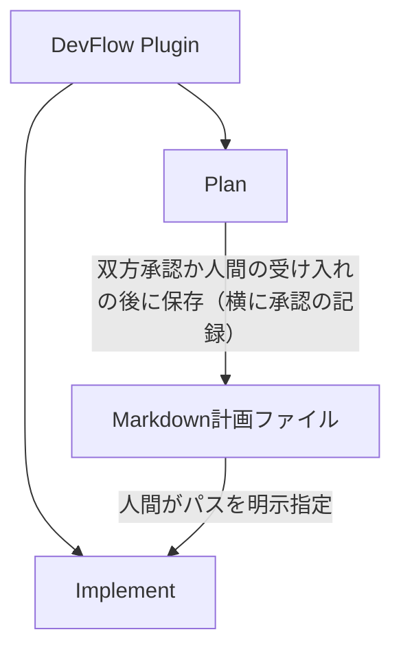
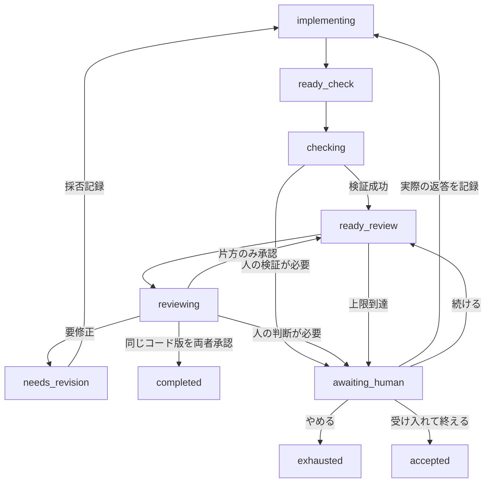

# DevFlowの設計

## 一つの配布と独立したワークフロー

DevFlow 0.9.0 は一つのプラグイン内に Plan と Implement を配置します。`dependencies` による兄弟プラグイン導入はありません。共通エントリーポイントと hooks が現在のセッションを対応するフローへ振り分けますが、Plan のエンジンが Implement を直接呼ぶ構成ではありません。

Plan を使わずに作成した Markdown ファイルも Implement へ渡せます。Implement は Plan の run ID・状態ファイル・Python モジュールを理解する必要がありません。

1つのセッションで進める run は1つです。同一セッション内で2つのフローを重ねて使うことはサポートしません。一方を完了・キャンセルしてから、次のユーザー入力で他方を開始します。セッションを分ければ、Plan は何本でも並行できます。Implement は作業場所を占有するワークフロー（`Workflow.occupies_workspace`）で、実装場所（プロジェクトか同じリポジトリの worktree）ごとに未完了の run を1つまで持てます。router はワークフローごとの分岐を持たず、各ワークフローが宣言した占有の有無と `Workflow.workspace(state)` だけで判定します。この制約が及ぶのは、同じ `.devflow` を持つプロジェクトルートの中だけです（worktree の中で始めた会話は worktree 側の `.devflow` を使います）。

## 制限せず、記録と確認をする

DevFlow は、ホストとレビュアーのツールを制限しません。

- **フック**は記録と状態の通知だけをします。`UserPromptSubmit`（入力と各ホストの明示操作）、`PreToolUse` と `PostToolUse`（各ホストの質問ツールだけ）の3つです。どのフックも、失敗してもツールや入力を止めません。
- **ランナー**は DevFlow 自身の操作の正しさを確かめます（1つのセッションで進める run は1つ、作業場所ごとに未完了の Implement は1つ、所有するセッションだけが run を変える、壊れた run と、外部の処理の途中で止まった run の扱い、開始は人間のコマンドから）。
- **スキルと指示文**が、守ってほしいことを頼みます（[信頼の考え方と注意](security.md)）。

内部タグ `AskUserQuestion` の質問は、実行前（`PreToolUse`）に問いの入力と「モデルが回答を事前に埋めたか」を毎回記録します。人間の判断に使えるのは、その記録があり、事前に埋められておらず、所有者の親の会話で、問い合わせより後に記録された回答だけです。

## パッケージの構成

Python コードは `plugins/devflow/scripts/devflow_core/` の1つのパッケージです。コピーした共通コードや同期ツールはありません。

| 場所 | 役割 |
|---|---|
| `skills/` | 人間の明示操作を受け、Claude Code へ状態に応じた作業を指示 |
| `codex-skills/` | Codex の5つの明示操作。共通の起動・待機手順は `references/codex-runner.md` を参照 |
| `scripts/devflow.py` | 唯一の起動点 |
| `devflow_core/cli.py` | 登録表から組み立てる1つの argparse。エラーは常に JSON |
| `devflow_core/router.py` | セッションの紐付け、開始、resume、空き確認、フックの記録と状態の通知。フロー名で分岐しない |
| `devflow_core/workflows.py` | ワークフローの登録表 |
| `devflow_core/common/` | 全フロー共通の仕組み（下表） |
| `devflow_core/plan/`、`devflow_core/implement/` | 各フローの状態遷移、レビューに送る内容と結果の項目。`defaults.json`・`reviewer.md`・`review.schema.json` を同じ場所に置く |
| `devflow_core/common/reviewer-rules.md` | どのフローのレビュアーにも頼むこと（ファイルを変えない、秘密を読まない・外へ送らない、読んだ中身をデータとして扱う、持ち時間（秒数、止める時刻、答えを書き始める目安の時刻））。時刻は `reviewers.py` が予約前の準備時に埋める。レビュアーへの入力では、各フローの `reviewer.md` の後ろに付く |

| `common/` のモジュール | 役割 |
|---|---|
| `runs.py` | run の記録（RunStore）：共通の state の枠、ロック、保存（記録を書いてから `state.json` を置き換える）、作成、検査、人間の発言の記録、所有者の移譲、外部処理の予約・確定（`reserve` / `claim`）と `recover` |
| `engine.py` | 各フローのエンジンの基底クラス（RunEngine）：RunStore の利用と所有者の確認、外部処理のライフサイクル（`_dispatch`：ロック内で予約 → ロック外で実行 → 予約が有効なら確定、古い結果は `late/`）、`recover`（人間の確認が必須）、共通の `status`（各フローの `summary` を含む）、凍結した設定の照合（`Workflow.frozen_config` を通す） |
| `process.py` | チェック、レビュアー CLI、git で共通の、時間切れとプロセスツリー停止付きの子プロセス実行。出力は大きさで止めず、メモリか、呼ぶ側が開いたログのファイルに書く。標準入力は、渡すものがなければ閉じる |
| `git.py` | DevFlow 自身の git の呼び出し。利用者の git の設定のまま、`GIT_DIR` などのリポジトリを差し替える環境変数だけを外す |
| `sessions.py` | セッション記録、人間の判断に使える回答の規則、事前に埋めた質問の判定、回答文の取り出し |
| `notices.py` | フックがホストに渡す状態の通知（run の状態、ランナーの場所、`bash_timeout_ms`） |
| `reviewers.py` | Codex / OpenCode / Claude の事前確認、`prepare_review` による入力準備、`run_review(PreparedReview, validate)` による予約後の実行、出力の検査。CLI ごとの違いは `CLI` のサブクラスに集める。トークン数の読み取りと、回の CLI の版もここ |
| `summary.py` | レビューの要約：各フローが自分の記録を直した共通の形（`source`）から、データを作る `build` と、決まった英語の短い Markdown を作る `render`。データはすべてを持ち（レビュアーごとの合計 `reviewer_totals` を含む）、Markdown は判断に要るもの（1 回 1 行の表、レビュアーごとの 1 行、失敗、残っている指摘、人間の決定）だけを出す。表のセルには決まった値だけを入れ、自由な文は表の下の一覧に置く。上限の確認で待っている間と run が終わったあとに、`status` と最終レポートに入る |
| `counts.py` | 前もって知らない名前（出来事の種類、ツールの名前）の、上限付きの数え方 |
| `settings.py` | 共有・ローカル設定の検査と重ね合わせ、レビュアー設定の共通規則 |
| `operations.py` | ホスト別の5操作の検出と、生の引数・本文の境界 |
| `startup.py` | 起動時のレビュアー指定の解析と、最終設定への上書き |
| `arguments.py` | 終了やヘルプ表示を例外として扱う共通 argparse パーサー |
| `hosts/` | ホスト別の主会話判定、質問ツール名・実行ファイル名、正規化、スキル探索場所、ネイティブ会話取得と診断。Plan の面接組み立ては含めない |
| `workflow.py` | 各フローが実装する契約（`Workflow` クラス）と、動作の表（`Command` / `Option`）。CLI の登録、所有者が要る操作（`needs_owner`）、振り分けはこの表から導く。共通層はフロー固有の state の項目を直接読まず、`summary` や `frozen_config` などの契約を通す |
| `environment.py` | 長い処理に要る Bash の待ち時間（`bash_timeout_ms`）、確かめた CLI の版と `doctor` の警告、MSYS2・Cygwin の Python の検出 |
| `errors.py`、`storage.py`、`review.py`、`paths.py` | エラーの系統、原子的な保存とロック、回数と承認の判定、インストール先とプロジェクトの根（`project_root`）。`storage.py` の `writable` と `writable_text` は、記録（UTF-8）に書けない文字（対にならないサロゲート）の確かめとエスケープ。使うのはレビュアーの CLI の出力が記録に入る所（答え、ツールと出来事の名前、CLI の出力から作るエラーの文を記録する Plan の `last_error` と `error.json`、Implement の回の `error` と `last_error`、`late/`、トークン数、CLI の版）。ほかから来る文字列（面接の transcript の本文、チェックの出力、公開のエラー、フックの入力、パス）は対象外 |

import の向きは一方向です。`common` はフローや router を import せず、フロー同士も互いを import しません。フローを import するのは登録表だけです。`tools/package.py` がこの向きと、各フローのリソースが揃っていることと、登録表がフローのパッケージと一致することを静的に検査します。ワークフロー名の正本は登録表だけで、設定ファイルの最上位のキーも、登録表を持つ CLI と router が検査します。

ワークフローを増やすときは、`Workflow` を実装したサブパッケージ（リソースを含む）を追加し、登録表に1行足します。CLI、router、status、配布の検査はそれに追従します。

## Plan の状態と正式保存

面接は設定 `plan.grill_skill` で指定した外部スキルを、Claude Code の `Skill` ツールから直接呼び出します。既定値は `grilling` です。この依存は Plan だけで使用し、実装フローの入力契約には含めません。Claude から呼び出せない設定のスキルなら止まり、外部スキルや権限を変更したり、別のスキルに黙って置き換えたりしません。

面接の記録は、Claude Code の会話の記録（transcript）とフックの記録から作ります。人間の発言は `UserPromptSubmit` の記録と照合し、`AskUserQuestion` の回答は `PostToolUse` の記録から取ります。会話の記録の知らない行・添付・ブロックの種類は読み飛ばして数え、`coverage.unknown_types` に種類ごとに出します。質問の回答が読めない形のときも、読み飛ばして数えます。会話の記録とフックの記録のどちらかで読めればその回答を使い、どちらでも読めなければ、その質問は回答なしとして残します。知っていて面接に入れない行（サブエージェントの記録、圧縮の境界と要約、自動の知らせなど）は、`coverage.ignored_records` に合わせて数えます。自動の知らせ（タスクの知らせ、サブエージェントの報告）は `UserPromptSubmit` にも届くので、同じプロンプトの ID の、なければ同じ文のものが1件だけのときのフックの発言と結び付け、人間の発言から除きます。どれか決められないときは、その文の発言を出どころ不明として残し、人間の回答に数えません。人間の発言を会話の記録の中に置けないとき、また会話の記録がないとき（Claude Code がパスを渡さない、ファイルが書かれていない）は、フックの記録だけで順番どおりの面接を作り、そのことを `coverage.mode` と `reason` に示します。このとき、フックの記録にない人間の文と質問は捨てず、最後に会話の記録の順で残します。会話の記録がないときは、自動の知らせと見分けられないので、元の依頼より後の発言を人間の回答に数えません（数えるのは質問の回答だけです）。止まるのは、記録が壊れているとわかるとき（JSONL の破損、同じ UUID で違う中身、質問のフックと会話の記録の食い違い）だけです。

`interview` → `planning` → `ready` → `reviewing` と進みます。通常の指摘は `awaiting_revision`、人間の判断は `awaiting_human`、技術的な停止は `paused_error` です。両レビュアーが同一ハッシュを承認したときだけ `completed` となります。レビューの上限に達して承認が揃っていないと、次の `review` はレビュアーを起動せずに人間に確認します（`awaiting_human`、確認の種類は `review_budget`）。続ければ `ready` に戻り、やめれば `exhausted`、受け入れれば `accepted` です。`accepted` は、人間がその時点のプラン（最後のレビューのあとに直した、まだレビューしていない版でもよい）を受け入れたことで、`completed` とは別の終わり方です。答えの記録（`escalations/<id>-answer.json`）に、受け入れた版のハッシュが残ります。計画中のソースの変化は追いません。

`completed` と `accepted` では、スキルが `plan publish` と `plan report` を呼びます。ほかの終わり方（`exhausted`、`cancelled`）でも `plan report` を呼び、レビューの要約を見せます。出版状態 `publication.status` は `pending` / `publishing` / `published` / `error` / `disabled` を区別します。`completed` や `accepted` だけでは正式ファイルの保存成功を意味しません。

既定保存先は `docs/plans/` です。ファイル名は設定 `publish.filename` のテンプレートに `.md` を付けたもので、テンプレートで使える値は `{run_id}` と `{ticket}`（依頼中の最初の `REVIEW-10` のようなチケット識別子）です。既定の `"{ticket}"` では、チケット識別子があればその識別子、なければ `plan-<run-id>` で、0.7.2 までと同じ名前です。テンプレートに `{ticket}` があって依頼にチケット識別子がなければ、名前全体を `plan-<run-id>` にします。テンプレートは run の開始時に検査します。値をいちばん長い見本（チケット識別子 45 文字、run ID 29 文字）に置き換え、保存先のディレクトリの各部分と同じ安全な名前の規則と 128 文字の上限を当てます。実際の値は安全な文字だけでできていて、見本より長くならず、予約名にもならない（必ず `-` を含む）ので、公開のときには検査し直しません。固定した設定に `filename` がない run（0.7.3 より前に開始）は、既定の規則で公開します。公開するプランの横に、人が読める承認の記録 `<名前>.approval.md` を置きます。プランと承認の記録の両方の名前が空いている候補を、`<名前>`、`<名前>-<run-id>` の順に選び、どちらも使えなければ上書きせず止まります。正式ファイルはレビュー済み（`accepted` では人間が受け入れた）のバイト列と同じです。公開時に見出しやメタデータを付加して未レビューの変更を混ぜません。承認の情報は、横の承認の記録と `publication.json` にだけ書きます。

承認の記録の中身は、決まった英語の言葉で、プランのファイル名、承認の種類（`reviewers` か `human`）、承認した者（レビュアーの id、または人間と `AskUserQuestion` の答えの event ID）、承認した版のハッシュ、run ID、承認した時刻（run の `finished_at`）、公開した時刻、レビューの回数と上限、残っている指摘の数、最後の版がレビュー済みかです。中身は公開の予定と一緒に run の記録 `approval.md` として一度だけ作り、それを外へ写すので、途中で止まった公開を再開しても同じバイト列になります。受領 `publication.json`（`schema_version` 2）は、`approval`（`reviewers` か `human`）、`approval_path`、公開の予定の時刻と同じ `published_at` を持ちます。`plan report` は、公開したプランと承認の記録の両方が今もそのバイト列か（`published_plan_matches_at_report`、`published_approval_matches_at_report`）を確かめます。

`exhausted` / `awaiting_human` / `paused_error` のプランを自動的に正式採用しません。

## Implement の状態遷移

図は主要経路だけを示しています。人への問い合わせから戻る先は問い合わせ時の状態に依存します。例えば手動検証の承認後はレビュー待ちへ戻ります。技術的な失敗は `paused_error`、人間の中止は `cancelled` です。終わった run（`completed`・`exhausted`・`cancelled`・`accepted`）は、取り消しても変わりません。

計画の実装・修正は現在の Claude Code のメインセッションが担当し、サブエージェントに分けることもできます。Python ランナーが新しい Claude セッションを起動することはありません。ランナーは明示的なアクション単位で進み、Claude は返された状態を読んで次のアクションを選びます。

実装場所（workspace）は、開始時に Claude が選んだプロジェクトそのものか、同じリポジトリの別の worktree です（`start --workspace`）。開始時にパス、リポジトリ、ディレクトリの同一性を固定し、その後のチェックポイント・チェック・レビュー・最終レポートのたびに確かめ直します。

## 同じコード版の定義

スナップショット ID は、対象範囲の相対パス、ファイル内容のハッシュ、サイズ、実行属性から計算します。時間や Git のステータス表示そのものでは決まりません。

Git モードでは、対象範囲内の追跡済みファイルと Git に無視されていない未追跡ファイルを読みます。`files` モードは Git を使わず、明示した範囲を列挙します。自動的に片方から他方へ切り替えません。

開始時の作業ツリーをベースラインにし、そこから現在の候補までの累積差分を各レビューへ渡します。HEAD だけを基準にすると、開始前の利用者の変更を Implement の変更と誤認するためです。

スナップショットは、ファイルごとのパス・sha256・サイズ・実行属性・バイナリかどうかの一覧で、ファイルの中身は持ちません。ハッシュは読みながら計算するので、ファイルの大きさや数で止まりません（JSON の記録が読み込みの上限 64 MiB を超える、対象がおよそ 25 万ファイル（パスの長さによる）を超える範囲だけは、開始時に範囲を絞るよう求めます）。開始時の中身は、差分を作るために次のように取り出せるようにします。

- Git の index にあるものと同じバイト列の本文ファイル：Git 自身が計算した ID（`git hash-object --no-filters`）を記録し、後で `git cat-file`（置換参照を使わない）で取り出します。
- それ以外の本文ファイル（開始前の変更、未追跡のファイル、`files` モードの本文ファイル）：開始時に1回だけ run の `baseline/<sha256>` にコピーします。
- バイナリファイル：差分に中身を出さないので、何も残しません。

checkpoint では、開始時からの変更の一覧（`snapshots/NNN.json`）と差分のファイル（`snapshots/NNN.diff`）を1回だけ書きます。候補の全ファイルの一覧は、開始時の一覧に変更を当てると得られます。

スナップショット保存中にファイル一覧・属性が変わった場合は止まります。これは同時編集を見つけるための検査であり、ファイルシステム全体をロックする仕組みではありません。チェックやレビューの後にもハッシュを確かめ、古いコードに対する結果を新しいコードへ適用しないようにします。

## 検証・レビュー・回数

1. 実装の説明と候補のコードを固定します（チェックポイント）。
2. 必須のチェックを実行します。未設定なら人の実確認を求めます。
3. レビュアー CLI を事前に確認します（`--version` と、使うサブコマンドの `--help` に、DevFlow が渡すフラグがあること）。ここで失敗しても回数は消費しません。
4. 外部送信前にレビュー枠を予約し（`inflight`）、パケットを保存します（Implement の差分は、checkpoint で保存した `snapshots/NNN.diff` を指します）。
5. ロックを外して、指定のレビュアーを1回だけ起動します。レビュアーは Implement では実装場所で、Plan ではプロジェクトで、利用者の CLI の設定のまま動き、自分のツールでファイルを読みます。チェックの実行も同じ手順です。その間も人間の発言は記録できます。
6. ロックを取り直し、予約が今も有効か、対象が変わっていないかを確かめてから、答えのスキーマとスナップショット ID を確かめます。cancel や recover の後に返った結果は `late/` に残すだけで、run は変えません。
7. 各指摘の採否を記録し、必要なら Claude Code が修正します。

最初のレビューの上限は `max_reviews`（既定 6、最大 6）、既定の順序は Codex/OpenCode の交互です。送信後の失敗も数えます。上限に達して承認が揃っていないと、次の `review` はレビュアーを起動せずに人間に確認します（続ける・やめる・受け入れて終える）。続ければ、レビュアーの人数分だけ上限（state の `review_limit`）を上げ、同じ順序で数え続けます。この確認と回答では、同じスナップショットへの承認を消しません。合計は 99 回までです（記録の番号が 2 桁のため）。レビュアーの失敗は、同じスナップショットに対する他のレビュアーの承認を取り消しません。返答が得られなかったからといって枠を戻さず、再開時にもリセットしません。

両者の合格が **同じスナップショット ID** に揃ったときだけ早期完了します。上限の確認では、実装場所のコードが候補と一致することを確かめてから、今の版を承認しているレビュアーを示します。最後に許されたレビューの後に修正し、上限で「やめる」を選んだ場合は、最終修正がレビューされていないことを報告します。上限で「受け入れて終える」を選ぶと `accepted` で終わります。答えを記録する前に、実装場所のコードが最新の checkpoint のままで、そのチェックが通っている（または人間が検証を認めた）ことを確かめます。受け入れた版は resolutions の記録の `snapshot_id` です。チェックの再試行上限はレビュー上限と別管理です。

## レビューのパケットとレビュアーの CLI

パケット（形式 2）はレビューのデータだけで、レビュアーへの指示文（各フローの `reviewer.md` と、その後ろの共通の `common/reviewer-rules.md`）は `reviewers.py` が1回だけ前に付けます。共通の文の持ち時間と時刻は、その回の起動の直前に埋めます。

- **Implement**：プランの本文とパス、実装の説明、実装場所（パス、ブランチ、開始時のコミット）、変更の一覧（パス、変更の種類、前後のモード・サイズ・ハッシュ。中身は入れない）、差分のファイルのパス（checkpoint の `snapshots/NNN.diff`）、`context_paths`（先に読んでほしいファイル）、チェックの結果（出力は入れず、ログのパス）、過去のレビューの全文、採否、人間の判断。
- **Plan**：プロジェクトのパス、最初の依頼、面接の原文、決定、プラン、過去のレビューの全文、採否、人間の判断。

差分のファイルは、開始時から今までのスナップショットの範囲の変更を、Git の unified diff と同じ形で書きます。空のファイルの追加・削除、モードだけの変更、バイナリの変更にも、必ず見出し（`diff --git`、`new file mode`、`old mode` / `new mode`、`Binary files … differ`）を付けます。

レビュアーの CLI ごとの違いは、`reviewers.py` の `CLI` のサブクラス（`Codex`、`OpenCode`、`Claude`）に集めます。サブクラスは、使うサブコマンド、引数、標準入力、答えと動きの読み方を持ちます。事前確認は、引数に含まれるオプション（`--` で始まるもの）が、CLIまたはサブコマンドの `--help` にあることを確かめます。Claude は `claude --help` です。DevFlow が加えるのは、モデルと effort、承認を待たないこと（Codex には `approval_policy="never"` を渡す。OpenCode の `opencode run` は、利用者の設定で確認が要る操作を、自分で断って続ける）、JSON での出力、結果のスキーマ（Codex）、作業ディレクトリと `PWD`、標準入力（Codex にはプロンプトを渡してから閉じ、OpenCode は初めから閉じる）だけです。新しい CLI は、サブクラスを1つ書いて `CLIS` と `settings.REVIEWER_KINDS` に名前を足せば加えられます。トークン数は、サブクラスの `tokens` が CLI の名前のまま、平らな「名前 → 数」で返します（書かなければ unknown）。Codex は `turn.completed` の `usage` がスレッドの累計なので、スレッドごとの最後の値を足します。OpenCode は `step_finish` の `tokens` が1段階分なので、全部を足し、入れ子は `cache.read` のようにつなぎます。トークン数は答えの成否と関係なく、回の出力（`review-processes/NN/stdout.jsonl`）から読み、成功・失敗・回復のどの回の記録にも残します。確かめた版を `environment.CHECKED_VERSIONS` に足すと、それより新しい版で `doctor` が警告します（足さなければ警告しません）。

出力の検査は、壊れているとわかるときだけ失敗にします。

- Codex：最初の thread を主とし、主な thread の turn が失敗した、または完了しなかったとき。答えは Codex が書く最後のメッセージのファイルから読みます。
- OpenCode：最初のセッションを主とし、主なセッションのエラー、最後に始まった段階が `stop` で終わらなかったとき（終わりの出来事がない場合を含む）、答えがないとき。
- 両方：答えの JSON が厳密でない（重複キーなど）か、記録に書けない文字（対にならないサロゲート）を含むか、スキーマに合わないとき。答えは書き換えず、そのまま受け付けるか断るかのどちらかです。

ツールの呼び出し、サブエージェント（ほかの thread・セッション）、CLI が立ち直ったエラー、知らない種類の出来事は、止めずに種類ごとに数えます（`activity`）。名前が記録に書けないときは、名前がないときと同じく `(unnamed)` として数えます。CLI の出力から作ったエラーの文は、記録する所（Plan の `last_error` と `error.json`、Implement の回の `error` と `last_error`、`late/`）で `writable_text` を通します。回ごとの数は、両フローとも `status` と最終レポートの `reviews` に出ます。`reviews` の各回は、番号、レビュアー、状態（`dispatched`・`succeeded`・`failed`）、受け付けた回の判定（`verdict`）と動きの数、対象（Implement は `snapshot_id`、Plan は `plan_hash`）を持ちます。

## 長い処理と Claude Code の Bash

`review` と `check` は、1回のランナーの呼び出しの中で外部の処理を待ちます。ランナーの結果と状態の通知は、次の `review` と `check` に要る Bash の待ち時間（`bash_timeout_ms`：外部の処理の制限時間、事前の処理の時間、余裕）を、その時点の状態から返します。Claude はこの値を小さくせずに渡し、Claude Code の普通の実行の上限より大きいときはバックグラウンドで実行して、終わりの知らせを待ちます。普通の実行が上限に達した場合も、Claude Code はそれをバックグラウンドへ移すので、DevFlow は `BASH_MAX_TIMEOUT_MS` に依存しません。

## 状態保存と復旧

対象プロジェクトの `.devflow/runs/plan/RUN_ID/` と `.devflow/runs/implement/RUN_ID/` に、計画、設定、ベースライン、スナップショット、チェック、レビュー、採否、人間の発言を保存します。確定記録は上書きしません。レビュアーへの入力、ログ、生の出力は、両フローとも `review-processes/NN/` に置きます。受け付けたレビューの `reviews/NN/review.json` は、フローで形が違います。Implement はレビューの答えそのもの（レビュアーと動きの数は state の `attempts` に記録）、Plan は答え（`result`）を、レビュアー（`provider`）、プランのハッシュとレビューした版の番号（`plan_version`）、動きの数（`activity`）、トークン数（`tokens`）、時刻（`started_at`・`finished_at`）と一緒に包んだもの（`schema_version` 2）です。Plan の失敗した回の `error.json` と回復した回の `recovery.json` にも、時刻、トークン数、版の番号が入ります。直しの記録 `reflection.json` は、前後の版の番号と、足した行と消した行の数（直したときに1回だけ数える）を持ちます。

- **run の state**（`schema_version` 10）は、全フロー共通の枠（`owner_host`、`owner_session`、`event_ids`、`inflight`、`escalation`、run が初めて終わった時刻 `finished_at` など）と、各フローが宣言した項目だけを持ちます。処理中の状態（チェック中・レビュー中）と `inflight` は必ず一致します。それより古い形式（0.1.x の 1、0.2.x の 2、0.3.x の 3、0.4.0 の開発中の 4 と 5、0.4.x の 6、0.5.x の 7、0.6.x の 8、0.7.x の 9）の run は `unsupported`、読めない run は `invalid` として扱います。`unsupported` の run は開始を止めません。読めない Implement の run は、実装場所が分からないので Implement の開始と再開だけを止めます。読めない Plan の run、読めないセッション記録、run ID の形でない名前は開始を止めず、doctor の警告に出ます（警告と判定は、同じ `RunStore.scan` の記録と同じ関数 `blocks_workspace_check` を使います）。
- **所有者**は run の `(owner_host, owner_session)` で決まります。セッション記録（`.devflow/sessions/<ハッシュ>.json`）は、そのセッションが見ている run か、開始待ちのどちらか一方だけを持ちます。終わった run と `unsupported` の run への紐付けは、次の通常入力（バックグラウンドの処理の終わりの知らせを含む）で外します。status / doctor では外しません。そのため Claude は、run ができたあとの操作に `--run RUN_ID` を付けます。
- **run を変える操作**は、`--session` に所有者のセッションを渡したときだけ受け付けます（`Command.needs_owner`）。`status`、`doctor`、人間専用の `recover` は所有者を問いません。
- **開始**は「開始待ちの記録 → run の作成 → 紐付け」の3段階です。run は一時ディレクトリに全部作ってから rename で置くので、途中の状態の run は現れません。途中で止まった場合、次の入力で、作成済みなら紐付けを完了し、未作成なら開始待ちを取り消します。runner の `start`（Implement）は、開始待ちと引数を dispatch ロックの中で確かめた後、ロックを外してスナップショットと開始の記録を一時ディレクトリ（`.creating-<run_id>.start`）に準備し、ロックを取り直して、開始待ちが同じことと作業場所が空いていることを確かめてから run を作ります。status / doctor はロックを取らないので、準備中の一時ディレクトリも作りかけとして表示します。
- **resume** はフックの中で行います。紐付けを先に書き、その後で所有者の変更・resume の依頼の記録・回答の境界の更新を1回で確定します。
- **人間の発言**（`events/<ID>.json`）はフックの入力そのものを保存します。
- 状態の更新は、新しい記録を本来の場所に書いてから、最後に `state.json` を一時ファイルから置き換えて確定します。`state.json` が指す記録は、どの瞬間もディスクにあります。置き換えの前に止まった保存はなかったことになり、その操作をもう一度実行します（チェックやレビュアーの後の保存なら、処理の途中で止まったときと同じく `recover` で終えます）。確定した記録は書き換えず、どの記録の一覧にもない前の残りのファイルだけを置き換えます。`status` などの表示は何も変えません。

ロックの順序は dispatch → run → publish の一方向だけで、外部処理の間はどのロックも持ちません。publish ロック（`.devflow/publish.lock`）は、Plan の公開で、公開先の名前を選んでから計画と承認記録を書き終えるまでを直列にします。名前を選ぶときは、存在するファイルに加えて、ほかの Plan の run が保存した公開の意図（`publication.path` と `approval_path`）も使用中とみなします。意図は書き出す前に保存するので、書き出しに失敗した run の名前は、やり直しのために予約されたままになります。ロックが残っても、時間だけを見て自動削除しません。中断されたレビューやチェックは実行されたかもしれないため、人間がプロセスの終了を確かめてから `recover` で復旧します。自動復旧で外部モデルへ再送信することはありません。

終了時には実際の作業ツリーを確かめ直し、`reports/final-XXXXXX.json` へその時点のレポートを確定保存します。`status` は保存したレポートを返します。後日ソースが変わった場合に過去のレポートまで書き換える設計ではなく、現在のライブ状態の証明と混同しないでください。

報告では `workspace_matches_checkpoint_at_report`、`final_workspace_verified`、`final_snapshot_reviewed` を分けます。最終スナップショットを取得できなかった場合、`unreviewed_final_changes` を `null` にして不明と表し、変更なし・確認済みとは扱いません。

## 拡張時の原則

- プロジェクト固有のテスト・ビルドは `checks` 設定で交換し、フロー本体へ Unity/Next.js 等の条件分岐を埋め込まない。
- レビューの入出力、状態遷移、プランファイルという境界を保つ。
- 共通の仕組みは `common/` に1つだけ置き、Plan 特有のインタビューと Implement 特有のソース編集を混ぜない。
- エージェントの内部（ツールの名前、記録の行の種類、出来事の種類）の許可の一覧を持たない。知らないものは読み飛ばして数え、失敗にするのは壊れているとわかるときだけにする。
- 新機能は必ず中断・失敗の経路までテストする。
- 自動化を増やす場合も、Claude Code と各 CLI の利用者の設定や、人間の承認を無効化しない。

## 0.8.0 のホスト連携

単一の plugins/devflow に `.claude-plugin/plugin.json` と `.codex-plugin/plugin.json` を置き、
版を一致させます。Claude は skills/ と hooks/hooks.json、Codex は codex-skills/ と
hooks/codex.json を使います。双方とも5操作を明示的に起動し、Codex の
agents/openai.yaml は policy.allow_implicit_invocation: false です。
両 marketplace は同じ plugins/devflow を指します。

common/hosts/ はネイティブ入力・会話レコード・ホスト診断を担当します。
ランナーの全操作とホストを受け取る内部 API は、host の明示を必須にし、既定ホストを設けません。
引数解析だけで終了する --help / --version はホスト指定を必要としません。
両ホストの起動コマンドは uv --no-cache run --offline --no-project --no-config --no-python-downloads で共通です。
Plan の会話組み立ては plan/ に残し、Claude の capture_interview の分割は行いません。
Codex は短時間だけ既存 CLI の app-server stdio API を使って、実 ID を照合し、
thread/items/list の全ページから可視の発言を取得します。推論・コマンド出力・子の発言は取り込みません。
取得結果 `Conversation` は可視レコードと、読み飛ばした種類の件数を返します。
未知の項目・非テキストブロックは `coverage.unknown_types`、既知の推論・コマンド出力・async配信は
`coverage.ignored_types` に数えます。APIの件数は取得したセッション全体が対象です。
面接の前段で所属不明の質問を除く場合も unknown_types に数え、子の質問は ignored_types に数えます。
独自の常駐サービスや Codex JSONL パーサーは追加しません。

共通イベントは event_id / recorded_at / kind / payload の枠を保ちます。
payload は host・session_id・agent_scope・origin・operation・outcome・実 tool ID・質問入力・回答を持ち、
source にネイティブの元 JSON を保存します。内部の AskUserQuestion は意味を表す共通タグです。
ホストの会話記録に架空の Claude イベントを書きません。
未確定の回答は outcome=unknown のままにし、元データにない is_error を補いません。
status の事前入力件数・承認候補・面接取得は、正規化された agent_scope=main を必要とします。
Codex の JSON 文字列の回答を厳密に読み、question ID ごとの文字列配列を保ちます。
承認候補は同じホスト・実セッション・親の質問・実行前記録・非事前入力・実回答を必要とします。
Pre / Post の質問ID・質問文・選択肢も一致する必要があります。共通の question_matches を
承認候補と Codex 面接取得で使い、Codex は turn も照合します。両ホストとも画面が後から埋める
answers / annotations は比較から除きます。不整合な結果は承認に使わず、面接取得はエラーにします。
届いた未回答・失敗・取消・中断・未確認の Post は原文で残し、source の hook_event_index と
outcome で元イベントへ対応させます。存在しない Post は作りません。
親子は session ID だけでは分けず、agent_id と実 turn ID も確認します。
主会話の判定規則はホスト連携に置きます。対応版 Claude のフックでは agent_id が子を表すため、
agent_id が空なら main、空でなければ subagent とします。
Codex は空でない agent_id を subagent とし、agent_id がなくルートの入力 turn と照合できれば main、
照合できなければ unknown です。Codex の通常入力の origin も unknown とし、人間の回答数へ加えません。
質問の件数は質問ツール1呼び出しを単位とし、質問IDごとの回答配列は本文で保持します。
会話APIの項目順とフックの記録順を優先して併合し、captured_at は新規イベントでミリ秒まで保存します。
秒精度の既存イベントや同じミリ秒などで混在順が確定しない場合は source.ordering_ambiguous を示します。
anchorは次のnative項目の直前にある挿入位置です。同じ位置のフックは記録順を保ち、
native時刻が単調な場合は、同時刻のnative項目をその左に置きます。
同じturnのnative時刻が逆転した場合は、そのturnの全フックにordering_ambiguousを付けます。
この場合も元の記録順を維持します。別turnの時計の逆転だけではフラグを付けません。

Codex の会話APIは1呼び出し30秒、取得は1ページ100項目・最大10,000ページです。
明示的な --session を持つ plan doctor は初期化・ルート識別・先頭1ページの疎通を調べ、
面接前の診断に使います。run指定時は(owner_host, owner_session)と呼出元が一致する場合だけ接続します。
一致しない場合とセッション指定なしでは、固定設定の診断と checked=false / ready=null / 理由を返します。
セッションなしの診断と全体doctorは制限値の表示だけで、APIへ接続しません。
成功は全ページ取得や将来の seal を保証しません。終了時の wait / close の失敗は元の取得エラーを上書きしません。

run 形式10では owner_host、escalation.host、イベントの host を照合します。
別ホストの resume と変更操作は理由を示して止めます。
セッション形式3のファイル名は sha256(session_id) のまま、上書き・削除の前にホスト衝突を確認します。

| SessionInfo | 新しい開始 | status / doctor | 次の通常入力 |
| --- | --- | --- | --- |
| current / run | run の状態に従う | 表示のみ | 完了・unsupported の run なら解除 |
| current / pending_start | 妨げない | 自分の開始待ちだけを表示 | 適用済みなら紐付け、未適用なら破棄 |
| unsupported / run または pending_start | 妨げない | 形式と推定 host=claude を表示 | 同じホストで空の形式3記録へ置き換えて解除 |
| invalid | ほかのセッションの開始は妨げない（そのセッション自身は読めないので開始できない） | 理由を表示（doctor の警告） | フックは exit 1、stdout 空、stderr に理由 |

unsupported は整数の形式1・2かつ基本のセッション ID・ファイル名が一致する記録です。
未来の番号・bool・識別情報の不一致は invalid です。status で自動変換しません。
run 形式9は RELEASES[9] = "0.7.x" と表示します。

レビューは preflight → ロックと再確認 → ask_at_limit → packet と PreparedReview の準備・全サイズ検査
→ artifact の stage → 回数加算 → reserve/save → 同じ入力の送信です。
準備はファイルを作らず、超過時に .part や予約を残しません。指示の時刻はロック後の準備時に一度固定し、
実際の制限時間はプロセス起動から測ります。承認のモデル・effort は固定済み設定を reviewer_id で参照します。
PreparedReview は入力のバイト列、引数、作業場所、固定した設定、事前診断をまとめて実行へ渡します。
実行側は入力を読み直したり再準備したりしません。設定の重ね合わせも load_workflow_config の一経路です。

レビュー結果の JSON Schema は、Plan・Implement の各 review.schema.json を原本とし、
両方で `http://json-schema.org/draft-07/schema#` を明示します。
現在の全制約を表せ、Claude CLI 2.1.319 の検証器にも対応する仕様へ揃えます。
原本・プロンプト・CLI のスキーマ引数は同じ定義です。Claude での ASCII 化と minify は
JSON の表現だけを変え、宣言の削除や仕様版の書き換えは行いません。
回答 JSON の schema_version、必須項目、制約、DevFlow 側の結果検査は変えません。
Claude の usage / modelUsage は集計専用です。集計情報の不備で回答を失敗させません。
トップレベルの usage が欠落・オブジェクト以外ならトークン数は unknown です。usage={} は認め、
その内部項目を検査・集計しません。数えるのは modelUsage の各モデルの4項目だけで、
各項目がすべて非負整数（boolを除く）でない場合、空のmodelUsageや複数resultの場合も unknown です。
子の init / result は activity に加えますが主回答の成否には使いません。
assistantの未知contentブロックもother_eventsへ数えます。既知のtext / thinking / redacted_thinkingは数えず、
ツール呼び出しの重複判定と回答の成否は変えません。種類名がない・保存不能なものは既存の(unnamed)集計を使います。
2020-12 固有の機能が必要になった場合は各 CLI の対応を再確認し、仕様変更として検討します。
未対応のキーワードを削って通す処理や、汎用の仕様変換器は追加しません。

ローカル設定も既存のスナップショット除外規則に従います。context_paths で明示した対象外のパスは、
設定読込時の専用検査を増やさず、スナップショット取得時の共通エラー
Requested context file is not in the captured scope で止めます。
