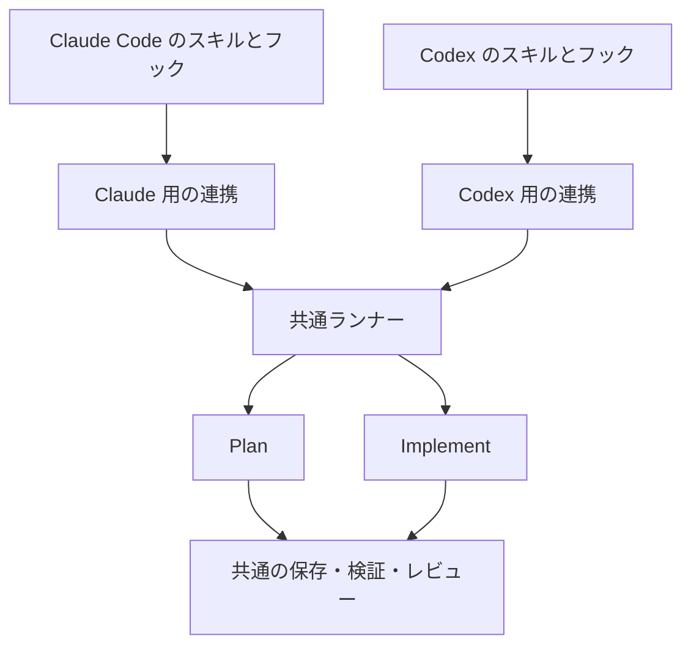

# Codex をホストとして使うための調査

> 2026-11-07追記: 本文は0.5.1を基準にした初期調査・設計案です。
> 0.7.3を基準に行った実測、確認できたことと未確認の条件は
> [Codex ホストの成立確認](codex-host-validation.md) を参照してください。
> 本文中の旧形式番号やフック構成を、現在の実装仕様として採用しないでください。

調査日: 2026-11-05。対象は devflow 0.5.1 の Codex 対応を検討するための公開仕様と、この環境の Codex CLI 0.166.0。実装は変更していない。公開資料で確認できた契約、インストール済みバイナリの観察、追加計測が必要な点を分けて記録する。

**推奨（再検討後）:** 共通の Python ランナーに、小さなホスト連携モジュールを追加する。両ホストで同じ5操作と判断の規則を提供し、各ホストの標準スキル・フック・質問機能を使う。独自の回答方式や中継サーバーは初期案に含めず、必要になった場合は実装前に確認する。以下の前半は調査した事実、後半は再検討した設計案である。

Codex は現在、スキルとライフサイクルフックの両方を備える。ただし、Claude 用フックのイベント名が一致するだけでは、質問への回答記録、子エージェントの区別、明示的な開始操作まで同じ意味で扱えるとは確認できない。特に、Default モードで人間の回答を確実に識別する経路は未検証である。

## 配布形式とスキル

公式資料は、ルートの `plugin.json` を使う可搬形式と、`.codex-plugin/plugin.json` を使う Codex 互換形式を説明している。可搬形式は `skills/` を自動探索し、OpenAI 固有設定は `extensions.com.openai` に置く。このオブジェクトがある場合、互換マニフェストの OpenAI 設定とはマージされない。[Package your plugin](https://developers.openai.com/plugins/build/plugins)

互換形式の `skills` は `"./codex-skills/"` のような相対ディレクトリ、またはその配列を宣言できる。`hooks` は相対パス、パス配列、インライン定義を指定できる。明示的な `hooks` がなければ `hooks/hooks.json` を探索する。パスの基準はプラグインルートであり、外側への参照は許されない。独立した Codex マニフェストでスキルとフックの入口を分ける構成は、この形式に合う。[Submission manifest fields](https://developers.openai.com/plugins/deploy/submission)、[Bundled hooks](https://developers.openai.com/plugins/build/plugins#bundled-mcp-servers-and-lifecycle-hooks)

ローカル marketplace は `.agents/plugins/marketplace.json` とユーザーの `~/.agents/plugins/marketplace.json` に配置でき、デスクトップは `.claude-plugin/marketplace.json` も互換位置として読む。`plugins[].source.path` は marketplace ルート基準の相対パスを指定する。インストール後はソース直下でなく `~/.codex/plugins/cache/` 内のコピーが使われる。この位置の互換性だけでは、既存の Claude 用カタログやマニフェストの全フィールドが無変更で動くとは確認できない。[Local marketplaces](https://developers.openai.com/plugins/build/plugins#how-local-marketplaces-work)

単独スキルは、起動位置からリポジトリルートまでの `.agents/skills`、ユーザーの `~/.agents/skills`、管理者の `/etc/codex/skills`、同梱スキルから探索される。シンボリックリンクにも対応する。CLI/IDE では `$skill-name` または `/skills` から明示選択でき、通常は説明文に応じた自動選択も行う。`agents/openai.yaml` の `policy.allow_implicit_invocation: false` で自動選択を止められる。[Build skills](https://learn.chatgpt.com/docs/build-skills)

プラグイン内スキルの識別名は `plugin-name:skill-name` と説明されるが、実際のセレクター表示とフックに届く入力文字列は別途確認する。`/devflow:dev` のような Claude 用コマンド表記がそのまま Codex の開始契約になる根拠は得られていない。[Skill identity](https://developers.openai.com/plugins/deploy/submission-errors#skill-errors)

`${SKILL_ROOT}` や `${SKILL_DIR}` が `SKILL.md` 本文で自動展開されるという公式契約は見つからなかった。スキルのファイル位置と同梱リソースへの相対参照を使う方針が資料に沿う。プラグインのフックコマンドには `PLUGIN_ROOT` / `PLUGIN_DATA` と、互換用の `CLAUDE_PLUGIN_ROOT` / `CLAUDE_PLUGIN_DATA` が渡る。ただし、この環境変数の説明はフック実行環境についてであり、スキル本文の置換機能を意味しない。[Supporting resources](https://developers.openai.com/plugins/build/skills#add-supporting-resources)、[Plugin hook environment](https://learn.chatgpt.com/docs/hooks#plugin-bundled-hooks)

## フックの公開契約

次の表は [Hooks](https://learn.chatgpt.com/docs/hooks) の要点を整理したもの。入力は標準入力の JSON で、共通項目は `session_id`, `transcript_path`, `cwd`, `hook_event_name`, `model`。対象イベントには `permission_mode`、ターン単位のイベントには `turn_id` がある。

| イベント | 主な入力・挙動 |
| --- | --- |
| `UserPromptSubmit` | `prompt: string`。マッチャーは無効。追加コンテキストを返せる |
| `PreToolUse` | `tool_name`, `tool_use_id`, `tool_input`。同期フックはツールの停止、引数の変更、追加コンテキストに対応 |
| `PostToolUse` | 上記に `tool_response` が加わる。実行済みの副作用は取り消せない |
| `Stop` | `stop_hook_active`, `last_assistant_message`。継続指示を返すと新しいユーザープロンプトとして処理される |
| `SessionStart` | `source` は `startup`, `resume`, `clear`, `compact`, `fork` |
| `SubagentStart` / `SubagentStop` | `agent_id`, `agent_type`。終了時は `agent_transcript_path` なども含む |

ツール名はモデルから見える関数名と一致するとは限らない。`exec_command` は `Bash` として扱われる。`apply_patch` は入力上も `apply_patch` で、マッチャーだけ `Edit` / `Write` を別名として受け付ける。`spawn_agent` は `Agent` でも照合できる。MCP と多くのローカル関数は対象だが、ホスト側 Web 検索などは対象外で、例外経路もある。コードモードの入れ子呼び出しにもフック判断が適用される。[Tool coverage](https://learn.chatgpt.com/docs/hooks#tool-coverage)

`additionalContext` の JSON 出力は `hookSpecificOutput.hookEventName` とイベントに対応した形を使う。`PreToolUse` の `continue: false` など、読み取りはできても動作未対応のフィールドがある。フック失敗時にツール処理が継続する場合もあるため、Claude 用出力を無変換で共有できるとは扱わない。複数の一致するコマンドフックは同時に開始される。[Common output fields](https://learn.chatgpt.com/docs/hooks#common-output-fields)、[PreToolUse](https://learn.chatgpt.com/docs/hooks#pretooluse)

フック定義はユーザー/プロジェクトの `hooks.json`、`config.toml` の `[hooks]`、有効なプラグインから読み込まれる。非管理フックは個々の定義を確認して信頼するまで実行されない。更新によって同梱スクリプトが変わった場合も再確認が必要。CLI の `/hooks`、デスクトップの Hooks 設定で確認する。プロジェクト層の信頼とは別条件である。[Hook discovery and trust](https://learn.chatgpt.com/docs/hooks#review-and-trust-hooks)

配布資料は、フック入りプラグインの手動導入先を Codex デスクトップとし、公開ディレクトリへの掲載対象から外している。一方、フック資料には CLI とデスクトップ双方の信頼 UI がある。CLI のプラグイン管理コマンドが存在する事実だけで、各導入経路・IDE・クラウドで同じ動作が保証されるとは判断しない。Web 上でのインストールは実行先へのスクリプト配置を行わない。[Plugin availability](https://developers.openai.com/plugins/build/plugins#bundled-mcp-servers-and-lifecycle-hooks)、[Claude plugin submission guidance](https://developers.openai.com/plugins/guides/submit-claude-plugin)

## セッション、子エージェント、履歴

フックの `session_id` は子エージェントでも親セッションの値になる。`SubagentStart` / `SubagentStop` の `agent_id` と区別する必要がある。通常のツールフックに子の `agent_id` が必ず含まれる、という保証はイベント表からは得られない。`transcript_path` は欠落可能で、ファイル形式も安定したインターフェースではない。[Common input fields](https://learn.chatgpt.com/docs/hooks#common-input-fields)

App Server には別に `thread.id` と `thread.sessionId` がある。後者はセッションツリーのルートを示し、fork でも共有される。履歴取得には `thread/turns/list` と `thread/items/list` があり、新しいローカルスレッドはページ分割履歴を使用する。固定の JSONL パスや Claude の履歴項目を前提にしない。再開には保存したスレッド ID で `thread/resume` を呼ぶ。[App Server thread lifecycle](https://learn.chatgpt.com/docs/app-server#start-or-resume-a-thread)

CLI 0.166.0 の生成スキーマでは、子スレッドの `source.subAgent.thread_spawn.parent_thread_id` と `depth` を確認できた。`thread.path` は不安定と明記されている。バイナリ内には `CODEX_THREAD_ID` / `CODEX_SESSION_ID` という文字列も存在するが、フックや任意シェルに必ず渡ることは確認していない。公開環境変数一覧にも両者の保証は見つからず、文字列の存在だけでは利用契約にならない。[Public environment variables](https://learn.chatgpt.com/docs/config-file/environment-variables)

## 質問への回答をどこから受け取れるか

App Server は実験的な質問要求 `item/tool/requestUserInput` と回答のマップを扱う。`serverRequest/resolved` は回答時だけでなく、ターン開始・終了・中断による要求の解消時にも発火するため、この通知だけでは人間の回答があった証拠にならない。通常の `turn/start` と途中入力の `turn/steer` も別経路である。[Question request lifecycle](https://learn.chatgpt.com/docs/app-server#toolrequestuserinput)、[Turn steering](https://learn.chatgpt.com/docs/app-server#steer-an-active-turn)

公式変更履歴には、`request_user_input_async` がモデルカタログで有効な場合に利用可能とある。通常の `request_user_input` と同じ利用条件・フック通知を持つとは記載されていない。[Codex changelog](https://learn.chatgpt.com/docs/changelog?date=2026-09-10&index=2)

この環境の観察では次の差があった。

| 観察対象 | CLI 0.166.0 の結果 |
| --- | --- |
| `codex features list` | `hooks` / `plugins` は stable、有効。`default_mode_request_user_input` は開発中、無効 |
| 生成した `ToolRequestUserInputParams` | `threadId`, `turnId`, `itemId`, `questions`, `isBlocking` が必須 |
| 同パラメーターの `autoResolutionMs` | 非推奨。公開ページにはまだタイムアウト用途の説明がある |
| `ToolRequestUserInputResponse` | `answers[question_id].answers` が文字列配列 |
| `userMessage` の生成スキーマ | `id`, `content` と任意の `clientId`。人間の承認を示す専用項目は確認できない |

使用した確認手段は `codex --version`、各サブコマンドのヘルプ、`codex features list`、`codex app-server generate-json-schema --experimental`。生成物は調査用の一時ディレクトリに置いた。モデル実行、プラグイン導入、フックの有効化、個人の認証情報の参照は行っていない。

**未確認:** `request_user_input` / 非同期質問それぞれについて、`PreToolUse` と `PostToolUse` が実際に発火し、回答がどの `tool_response` 形状で届くか。一般的なローカル関数の対応説明はあるが、質問ツール専用の保証は見つからない。Default モードで構造化質問が常に使えるとも扱えない。

**未確認:** `UserPromptSubmit.prompt` が `$skill-name`、セレクターによるスキル選択、プラグインのメンションをどう表すか。通常入力・途中入力・自動継続・子エージェント由来の入力を、同イベントだけでどこまで区別できるか。`Stop` フック自体が継続用ユーザープロンプトを作るため、「ユーザープロンプト」という呼称だけで人間由来と断定できない。

## 設計前に必要な小規模計測

1. CLI/デスクトップの対象バージョンで、手動導入とフック信頼後の発火を記録する。IDE やクラウドは別に対応可否を判定する。
2. Plan / Default と質問ツールの実際の公開状態を組み合わせ、回答・無回答・中断・再開のイベント列を記録する。
3. `$` による開始、セレクター選択、自動選択、通常メッセージ、途中入力、自動継続で `UserPromptSubmit` の入力と識別項目を比較する。
4. 子エージェントのシェル操作・質問・終了で、親セッション ID と子 ID を関連付けられるか確かめる。
5. 履歴ファイルがない場合も含め、標準機能で面接の原文と人間の回答の出所を確認できるか調べる。不足する場合は対応範囲と要件を整理して提示する。専用の返信方式を自動で追加することは、再検討後の案には含めない。

フック構文と互換用環境変数は再利用の足場になる。しかし、この時点で Claude 用フックだけを共通化すれば全機能が同等になる、という結論には至らない。

## 再検討した設計方針

ユーザーの「汎用性・拡張性と一貫性を重視し、一般的な実装を基本とする。複雑・特殊な実装は可能な限り避け、必要なら確認する」という条件を優先する。前案のホスト分離は残すが、Codex 独自の操作体系や回答方式は取り下げる。

これは設計案であり、対応済み機能やインストール手順ではない。主なコード上の根拠は [router.py](../plugins/devflow/scripts/devflow_core/router.py)、[sessions.py](../plugins/devflow/scripts/devflow_core/common/sessions.py)、[runs.py](../plugins/devflow/scripts/devflow_core/common/runs.py)、[面接の取得](../plugins/devflow/scripts/devflow_core/plan/transcript.py)、[起動と診断](../plugins/devflow/scripts/devflow_core/cli.py)、[配布の検査](../tools/package.py)。

### 前案から変更すること

| 観点 | 再検討後の方針 |
| --- | --- |
| 操作の一貫性 | Claude Code と Codex の両方に `plan` / `implement` / `status` / `resume` / `doctor` の5操作を提供する |
| 人間の判断 | 各ホストの標準質問機能と実際の回答記録を使う。Codex 専用の返信コマンドや回答方式を初期案から外す |
| 共通化の範囲 | 共通ランナーと小さなホスト連携モジュールに絞る。任意のエージェントを制御する仕組みには広げない |
| 標準機能で足りない場合 | 不足する機能と対応できない操作を明示する。特殊な代替方式を採用する前に確認する |
| 将来のホスト追加 | 同じインターフェースの実装と入口を追加する。共通フローにホスト別の条件を増やさない |

### 共通処理とホスト連携の二層にする



共通ランナーは、開始条件、所有者、実際の人間の回答を使える条件、状態遷移、レビュー回数、チェック、スナップショット、正式保存を担当する。ホスト連携は、ホスト固有の入力と記録形式をランナーが扱う小さなデータに変換する。承認の条件やレビューの規則をホストごとに実装しない。

ホスト連携のインターフェースは、次の三つの役割から始める。

| 役割 | 受け渡す内容 |
| --- | --- |
| ホスト入力の取り出し | 開始・再開の要求、質問前の入力、実回答、セッションの識別情報。元の記録も保持する |
| 面接記録の取得 | 開始から封印までの必要な原文、取得元、欠落の情報。内部推論や無関係な履歴は含めない |
| 導入診断 | 必須の標準機能・設定と、確認できたこと、未確認・未対応の理由 |

実装は通常の Python モジュールと関数を基本とし、共有する値の型には標準ライブラリの `dataclass` を使う。ホスト選択は一つの明示的な登録表に集める。クラスが有用になれば小さな `Protocol` で表すが、最初から継承階層や動的なモジュール探索を導入しない。

既存のホスト固有パーサーを分離する際は、その動作を維持して連携側へ移す。共通層から Plan / Implement を import せず、現在の一方向の依存関係を保つ。

現在の4種類の記録（`prompt` / `observation` / `question` / `stop`）と、その用途を出発点にする。任意のイベントを扱う基盤、イベントバス、新たな保存機構は追加しない。ホスト固有のツール名を共通処理の各所で検査する代わりに、質問・回答・出所など、実際に共通処理が必要な値だけを取り出す。

### 配布と操作も同じ形にそろえる

同じ配布物に、両ホストのマニフェストとスキルを入れる。現在の Claude Code 用の場所は保ち、Codex も同じ5操作に対応する短い入口を用意する。

```text
plugins/devflow/
  .claude-plugin/plugin.json
  .codex-plugin/plugin.json
  skills/{plan,implement,status,resume,doctor}/
  codex-skills/{plan,implement,status,resume,doctor}/
  hooks/hooks.json
  hooks/codex.json
  references/
  scripts/devflow.py
  scripts/devflow_core/
    common/
      hosts/
        __init__.py
        claude.py
        codex.py
    plan/
    implement/
```

Codex の互換マニフェストは専用のスキルとフックの場所を指定する。インストール・スキルの明示参照・質問・コマンド実行の操作説明は各ホストの標準方式に従う。表示上の呼び出し記法は異なっても、5操作の入力、意味、結果、完了条件はそろえる。

ワークフローの共通規則は参照文書に一度だけ書く。ホスト別の入口には、そのホストに必要なメタデータと呼び出し方だけを書く。ファイルを完全に共用するための大量のホスト分岐や、スキル・設定の生成器は作らない。

将来ホストを追加するときは、連携モジュール、マニフェスト・入口、記録のフィクスチャと契約テストを足す。`plan` / `implement` の状態遷移やレビュー処理を変更しなくても対応できることを目標にする。ホストとワークフローの組み合わせごとにエンジンを作らない。

### 標準機能で確認できる範囲を対応対象にする

最初に、Codex の標準の質問機能で、実際の回答、問い合わせとの対応、親の会話であることを確認できるか実測する。面接の原文取得も同様で、必要な内容が取得できたことを確認する。この二点が、Codex で Plan / Implement をどこまで提供できるかを決める。

確認できた実回答を共通の判断処理へ渡す。無回答、キャンセル、古い所有者、問い合わせ以前の回答は使わない。Claude Code 側は現在の質問機能を継続して使う。ホスト差の吸収を理由に、共通の判断条件を弱めない。

標準機能の不足が分かった場合は、`doctor` で機能・モードごとの理由を示す。`status` のように使える操作は提供できるが、必要な記録を取得できないワークフローは実行可能と表示しない。実行中に不足が分かった場合も、既存の待機・停止状態で理由を返し、承認済みとして進めない。

標準の設定やモードの選択で解決できる場合は、その通常の手順を案内する。利用者の設定を勝手に変更して対応済みとすることはしない。

前案の Codex 専用返信コマンド、質問 ID を利用者が入力する方式、質問のための独自 UI、App Server を中継する常駐処理は採用しない。既存の Claude 用履歴取得は保持するが、Codex の非公開・不安定な記録形式を広く解析する新しいパーサーも最初から実装すると決めない。標準の記録だけでは足りず、こうした対応が必要になった場合は、必要な理由、一般的な方法では足りない点、対象範囲、保守負担を具体化してから確認する。

この方針では、すべての Codex モードで同等の機能を直ちに提供できるとは限らない。標準機能で既存の契約を満たせる範囲を最初の対応対象とし、それを広げる際の特殊な実装は別途判断する。

### 保存・実行も既存の仕組みを使う

所有者はホスト名とセッション ID の組で識別する。プロジェクトを開始時に固定し、両ホストを合わせて未完了 run は一つとする。ロック、原子的な保存、レビューの予約と確定、失敗時の復旧は既存の処理を使う。これらをホスト別に作り直さない。

保存するホスト情報などは実際に必要な最小限にする。run の形式7とセッションの形式2を変更する必要があれば、既存のバージョン管理方針に従って更新する。汎用的なデータ変換器や複数形式の継続実行を、この機能のために追加しない。進行中の既存 run の扱いはリリース時に明記する。

ホストをまたぐ run の引き継ぎは初期対象に含めない。同じホストでの再開は既存と同じ意味とし、レビュー回数や開始時の基準を保つ。外部レビュアーは既存の Codex CLI / OpenCode CLI のままとし、ホストの種類でモデルやレビュアーを自動変更しない。

長い処理は共通ランナーが上限時間を管理し、ホスト側は標準のコマンド実行と完了待ちを使う。Codex の待ち合わせ間隔を Bash の実行上限として扱わず、ホスト別の短い操作説明で違いを吸収する。専用ジョブ管理サーバーや独自の待機機構は追加しない。

### 実装の順序と確認事項

1. **標準機能を実測する。** Codex の明示開始、標準質問と実回答、親子の識別、面接原文、通常モードでの利用可否を小さなプロジェクトで確認する。結果から対応範囲を決める。
2. **Claude 用の連携を分離する。** 現在の入力フィクスチャとテストで、既存の5操作と判断条件を維持する。共通処理にはホスト固有の名前を残さない。
3. **Codex 用の連携と5操作の入口を追加する。** 同じインターフェースを実装する。診断と状態表示、Implement、Plan の順に、要件を満たせた範囲を通す。
4. **共通の契約で確認する。** 両ホストの記録を同じケースに渡し、実回答だけが使えること、二重記録、所有者、同時開始、中断、レビュー回数を確認する。既存の偽 CLI によるテストと実機での確認を分ける。

専用の回答方式、新規の複雑な履歴解析、常駐処理、ホスト間引き継ぎ、既存の人間確認条件の変更が必要になった場合は、その部分に進む前に確認する。小さな連携モジュールの追加や既存のテストによる検証は通常の実装として進められる。

今回の変更は検討文書の更新だけであり、本体の実装や特殊な代替方式の導入は行っていない。
